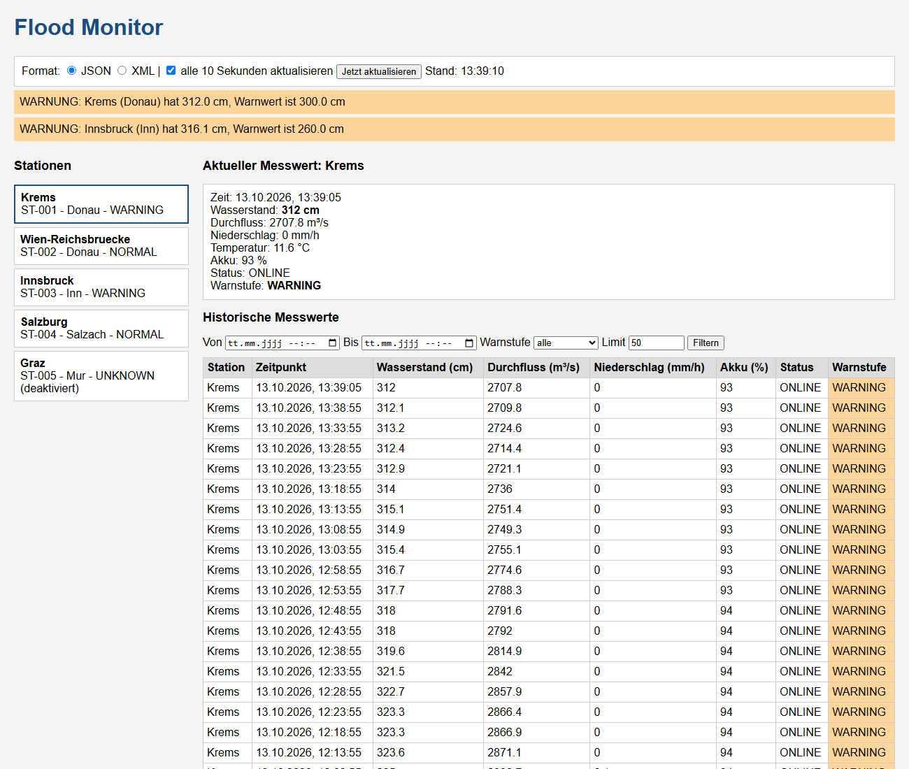

# DEZSYS_GK71 Flood Monitor REST

REST-Schnittstelle für ein Hochwasser-Frühwarnsystem mit Spring Boot. Es gibt 5 Messstationen, die
simulierte Messwerte liefern. Die Daten gibt es als JSON oder XML, dazu einen kleinen Webclient mit jQuery.



Weitere Dateien: [Fragestellungen](docs/FRAGESTELLUNGEN.md) · [Cheatsheet](docs/CHEATSHEET.md) ·
[AI-Prompts](docs/AI_PROMPTS.md) · [OpenAPI](docs/openapi.yaml) · [Beispiele](docs/examples) · [Angabe](TASK.md)

## Starten

Man braucht Java 17 oder neuer. Gradle ist über den Wrapper dabei.

```
.\gradlew.bat bootRun      (Windows PowerShell)
./gradlew bootRun          (Linux/Mac)
```

- Webclient: http://localhost:8080/
- API: http://localhost:8080/api/v1/stations
- Swagger UI: http://localhost:8080/swagger-ui.html

Tests: `.\gradlew.bat test`

Beim Start werden Messwerte für die letzten 6 Stunden erzeugt, danach kommt alle 10 Sekunden ein neuer Wert dazu.

## Konfiguration

In `src/main/resources/application.properties`, ein Beispiel ohne Schlüssel ist in `application-example.properties`.

| Property | Bedeutung |
|---|---|
| `simulation.enabled` | Simulation ein/aus (in den Tests aus) |
| `simulation.interval` | Intervall in ms (Standard 10000) |
| `simulation.history-hours` | wie viele Stunden Historie beim Start |
| `simulation.seed` | fester Seed, dann kommen immer die gleichen Werte |
| `security.api-key.admin` / `.reader` | API-Keys (über Umgebungsvariablen `FLOODMONITOR_ADMIN_KEY` / `FLOODMONITOR_READER_KEY`) |

## Aufbau

```
model        Station, Location, Measurement, WarningLevel, StationStatus
dto          StationList, MeasurementList, Alert, AlertList, Statistics, ErrorResponse
repository   StationRepository, MeasurementRepository (im Speicher, keine DB)
service      StationService, MeasurementService, AlertService,
             WarningLevelCalculator, Simulator, SimulationService, Params
controller   StationController, MeasurementController, AlertController
exception    ApiException, GlobalExceptionHandler
config       WebConfig, ApiKeyInterceptor, OpenApiConfig
static       index.html, css/style.css, js/app.js (Webclient)
```

Ablauf: Controller → Service → Repository. Die Controller machen nur HTTP-Sachen, die ganze Logik ist
in den Services. Fehler werfen eine `ApiException` mit Statuscode, der `GlobalExceptionHandler` macht
daraus die Fehlerantwort.

### Datenmodell

- **Station**: id, name, river, location (latitude, longitude), normalWaterLevel, warningWaterLevel,
  criticalWaterLevel (alles in cm), isActive, status, currentWarningLevel (wird vom Server berechnet)
- **Measurement**: stationId, timestamp (`Instant`), waterLevel (cm), flowRate (m³/s), rainfall (mm/h),
  temperature (°C), batteryLevel (%), status, warningLevel
- **WarningLevel**: NORMAL, WARNING, CRITICAL, UNKNOWN
- **StationStatus**: ONLINE, MAINTENANCE, OFFLINE

Stationen:

| ID | Name | Fluss | Normal / Warnung / Kritisch (cm) | |
|---|---|---|---|---|
| ST-001 | Krems | Donau | 250 / 300 / 380 | Pegel liegt um den Warnwert |
| ST-002 | Wien-Reichsbruecke | Donau | 300 / 450 / 550 | normal |
| ST-003 | Innsbruck | Inn | 180 / 260 / 320 | Schneeschmelze, oft kritisch |
| ST-004 | Salzburg | Salzach | 220 / 380 / 450 | Akku fast leer → MAINTENANCE |
| ST-005 | Graz | Mur | 150 / 230 / 290 | deaktiviert |

## Simulation

Klasse `Simulator`. Jeder neue Wert wird aus dem vorherigen Wert berechnet (ein Schritt ≈ 5 Minuten):

- **Regen**: fängt mit 4 % Wahrscheinlichkeit an, hört mit 7 % auf, dazwischen ändert er sich zufällig (0,2 bis 60 mm/h)
- **Wasserstand**: `+ 0,35 × Regen`, ohne Regen geht er langsam (4 % pro Schritt) zum Basispegel zurück,
  dazu ein bisschen Rauschen. Max. ±25 cm pro Schritt, nie negativ.
- **Durchfluss**: `mittlerer Durchfluss × (Wasserstand / Normalwasserstand)^1,6` → mehr Wasser = mehr Durchfluss
- **Temperatur**: ändert sich leicht zufällig, Regen kühlt ab
- **Akku**: verliert mit 12 % Wahrscheinlichkeit 1 %. Unter 15 % → MAINTENANCE, bei 0 % → OFFLINE.
  In MAINTENANCE wird der Akku mit 3 % Wahrscheinlichkeit getauscht, OFFLINE wird mit 2 % repariert.
- Deaktivierte und OFFLINE-Stationen bekommen keine neuen Messungen.

`SimulationService` ruft das per `@Scheduled` alle `simulation.interval` ms auf.

## Warnstufe

Wird nur am Server berechnet (`WarningLevelCalculator`). Schickt der Client eine Warnstufe mit, kommt 400.

| Bedingung | Warnstufe |
|---|---|
| Wasserstand ≥ kritischer Wert | CRITICAL |
| Wasserstand ≥ Warnwert | WARNING |
| Wasserstand ≥ 90 % vom Warnwert **und** (Anstieg ≥ 10 cm oder Regen ≥ 20 mm/h) | WARNING (Vorwarnung) |
| sonst | NORMAL |
| ungültiger Wert, keine Messung, Messung älter als 2 min, Station deaktiviert/OFFLINE | UNKNOWN |

## Endpunkte

Basis-URL: `/api/v1`

| Methode | Pfad | Beschreibung |
|---|---|---|
| GET | `/stations` | alle Stationen, Filter: `river`, `isActive`, `warningLevel` |
| GET | `/stations/{id}` | eine Station |
| GET | `/stations/{id}/measurements/latest` | neuester Messwert |
| GET | `/stations/{id}/measurements` | Historie, Filter: `from`, `to`, `limit` (1-1000, Standard 100), `warningLevel` |
| GET | `/stations/{id}/statistics` | Statistik (`from`, `to`, sonst letzte 24 h) |
| GET | `/alerts` | aktuelle Warnungen, Filter: `warningLevel` (WARNING/CRITICAL), `river` |
| POST | `/stations` | Station anlegen (braucht `X-API-Key`) |
| DELETE | `/stations/{id}` | Station löschen (braucht `X-API-Key`) |

`from`/`to` im ISO-8601-Format mit Zeitzone, z. B. `2026-05-01T08:00:00Z`. Die Historie kommt neueste zuerst.

## Beispiele

JSON (Standard, auch ohne Accept-Header):
```
curl -H "Accept: application/json" http://localhost:8080/api/v1/stations/ST-001/measurements/latest
```
```json
{"stationId":"ST-001","timestamp":"2026-10-13T11:39:05Z","waterLevel":312.0,"flowRate":2707.8,"rainfall":0.0,"temperature":11.6,"batteryLevel":93,"status":"ONLINE","warningLevel":"WARNING"}
```

XML:
```
curl -H "Accept: application/xml" http://localhost:8080/api/v1/stations/ST-001/measurements/latest
```
```xml
<?xml version='1.0' encoding='UTF-8'?>
<measurement>
  <stationId>ST-001</stationId>
  <timestamp>2026-10-13T11:39:05Z</timestamp>
  <waterLevel>312.0</waterLevel>
  <flowRate>2707.8</flowRate>
  <rainfall>0.0</rainfall>
  <temperature>11.6</temperature>
  <batteryLevel>93</batteryLevel>
  <status>ONLINE</status>
  <warningLevel>WARNING</warningLevel>
</measurement>
```

Weitere:
```
curl "http://localhost:8080/api/v1/stations?river=Donau"
curl "http://localhost:8080/api/v1/stations?warningLevel=CRITICAL"
curl "http://localhost:8080/api/v1/stations/ST-001/measurements?from=2026-05-01T08:00:00Z&to=2026-05-01T12:00:00Z&limit=100"
curl -H "Accept: application/xml" "http://localhost:8080/api/v1/alerts?river=Donau"
curl "http://localhost:8080/api/v1/stations/ST-001/statistics"

curl -X POST http://localhost:8080/api/v1/stations -H "X-API-Key: dev-admin-key" -H "Content-Type: application/json" -d "{\"id\":\"ST-010\",\"name\":\"Melk\",\"river\":\"Donau\",\"location\":{\"latitude\":48.22,\"longitude\":15.34},\"normalWaterLevel\":260,\"warningWaterLevel\":350,\"criticalWaterLevel\":450}"
curl -X DELETE http://localhost:8080/api/v1/stations/ST-010 -H "X-API-Key: dev-admin-key"
```

Mehr echte Antworten (JSON und XML) liegen in `docs/examples`.

## Fehler und Statuscodes

Alle Fehler gehen über den `GlobalExceptionHandler` und sehen so aus (als XML, wenn der Client XML will):

```json
{"timestamp":"2026-05-01T10:20:00Z","status":404,"error":"Not Found","message":"Station ST-999 wurde nicht gefunden","path":"/api/v1/stations/ST-999"}
```

| Code | Wann |
|---|---|
| 200 | alles ok |
| 201 | Station angelegt |
| 204 | Station gelöscht |
| 400 | falsches Datum, from nach to, falsche Warnstufe, limit < 1 oder > 1000, falscher Body |
| 401 | X-API-Key fehlt oder ist falsch |
| 403 | Lese-Key versucht zu schreiben |
| 404 | Station oder Messwerte nicht gefunden |
| 406 | Accept ist nicht JSON oder XML |
| 409 | Station-ID gibt es schon |
| 415 | Content-Type nicht JSON oder XML |
| 500 | sonstiger Fehler (ohne Stacktrace) |

## Sicherheit

- GET darf jeder, POST/DELETE nur mit `X-API-Key` (`ApiKeyInterceptor`). Es gibt einen Admin-Key und einen
  Lese-Key (der bekommt 403).
- Die Keys kommen aus Umgebungsvariablen, die Standardwerte sind nur zum Testen.
- Alle Parameter werden geprüft, `limit` ist auf 1000 begrenzt, unbekannte Felder im Body werden abgelehnt.
- Keine Stacktraces in den Antworten.

## Webclient

`src/main/resources/static`, mit jQuery:
- Stationsliste links, Klick zeigt den aktuellen Messwert
- Tabelle mit den historischen Werten, Filter nach Zeitraum, Warnstufe und Limit
- Umschalten zwischen JSON und XML (bei XML wird die Antwort mit `$.parseXML` gelesen und in dasselbe Objekt umgewandelt wie bei JSON)
- aktualisiert sich alle 10 Sekunden, zeigt „Lade..." und Fehlermeldungen vom Server an
- Farben: NORMAL grün, WARNING orange, CRITICAL rot, UNKNOWN grau

## Tests

`.\gradlew.bat test`. Es gibt 38 Tests. Die Simulation ist in den Tests aus (`application-test.properties`) und die
Uhr ist auf eine feste Zeit gestellt (`TestClockConfig`), deswegen kommt immer dasselbe raus.

- `FloodMonitorApiTest`: Stationen als JSON und XML, existierende/unbekannte Station, neuester Messwert,
  Zeitraum-Filter, from nach to, falsches Datum, Warnstufe NORMAL/WARNING/CRITICAL, 406, maximales Limit, Alerts, Statistik
- `StationWriteApiTest`: 401, 403, 201, 409, 415, 400, 204
- `WarningLevelCalculatorTest`, `SimulatorTest`

## API-Doku

Mit springdoc-openapi: Swagger UI unter `/swagger-ui.html`, die Spezifikation ist auch als
[docs/openapi.yaml](docs/openapi.yaml) gespeichert.

## Reflexion

- **Listen in XML**: Eine `List<Station>` wird in XML zu `<List><item>`. Ich habe deshalb Wrapper-Klassen wie
  `StationList` mit `@JacksonXmlElementWrapper(useWrapping = false)` gemacht.
- **isActive**: Jackson hat aus `isActive()` das Feld `active` gemacht. Mit `@JsonProperty("isActive")` gelöst.
- **Akku ging nie runter**: Ich habe zuerst 0,1 % pro Schritt abgezogen, aber der Akku ist ein `int`, also war er
  danach wieder gleich. Jetzt wird mit 12 % Wahrscheinlichkeit 1 % abgezogen.
- **406 ohne Fehlermeldung**: Wenn der Client z. B. `text/csv` will, kann Spring auch den Fehler nicht in dem Format
  schreiben. Ich setze beim 406 deshalb fix JSON als Content-Type.
- **Swagger YAML ging nicht mehr**, nachdem ich JSON als Standard eingestellt habe. Mit `MediaType.ALL` als zweitem Standard geht es wieder.
- **Tests zufällig**: Wegen der Simulation und der aktuellen Uhrzeit waren die Werte jedes Mal anders. Deshalb kann man die
  Simulation ausschalten und die Uhr ist eine Bean, die in den Tests fix ist.
- **Startbefehl**: In der PowerShell muss man `.\gradlew.bat` schreiben und im Projektordner sein.

## AI

Ich habe für die Umsetzung Claude Code verwendet, die Prompts stehen in [docs/AI_PROMPTS.md](docs/AI_PROMPTS.md).
