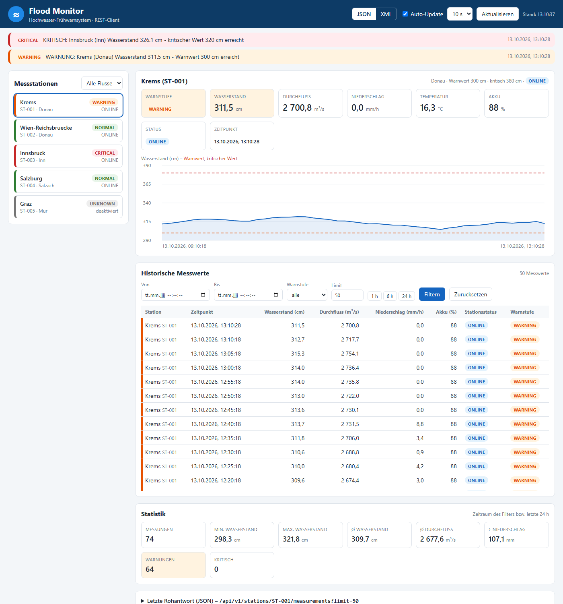
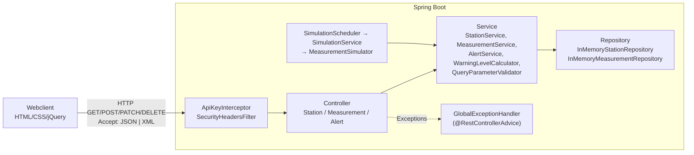
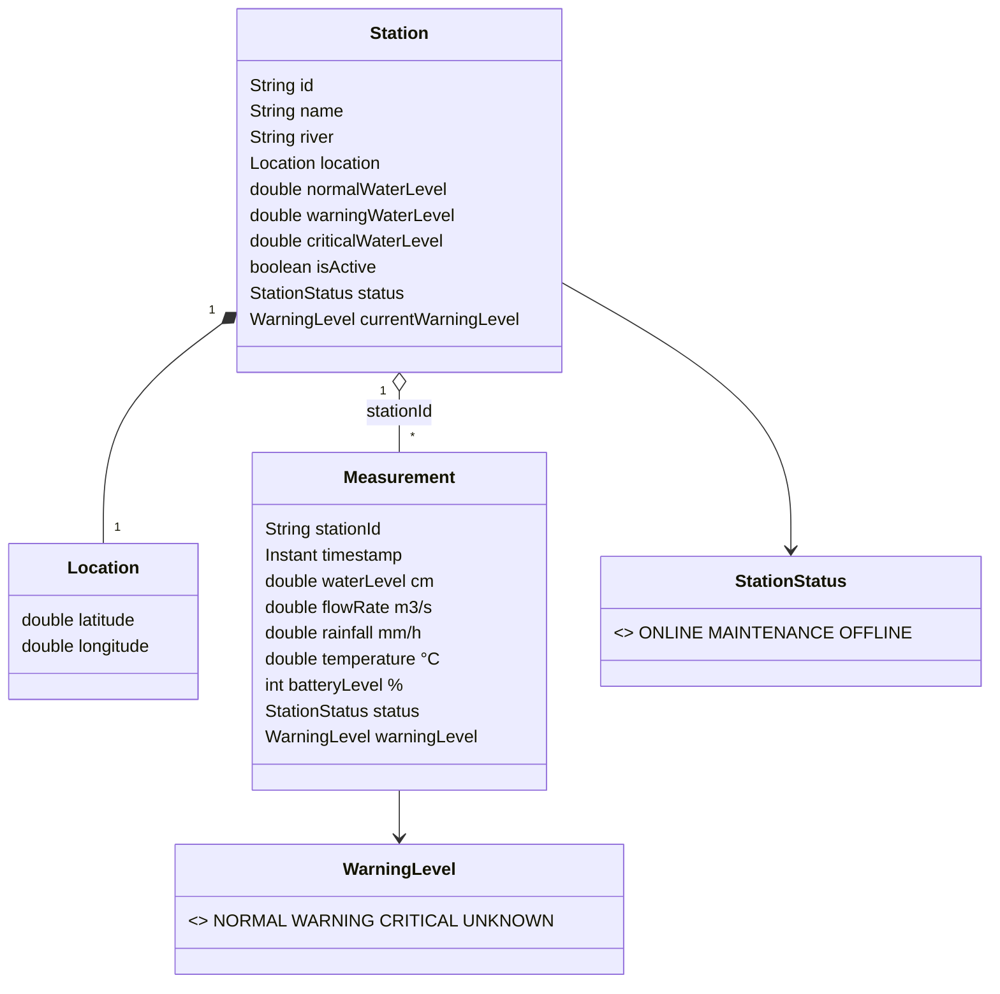
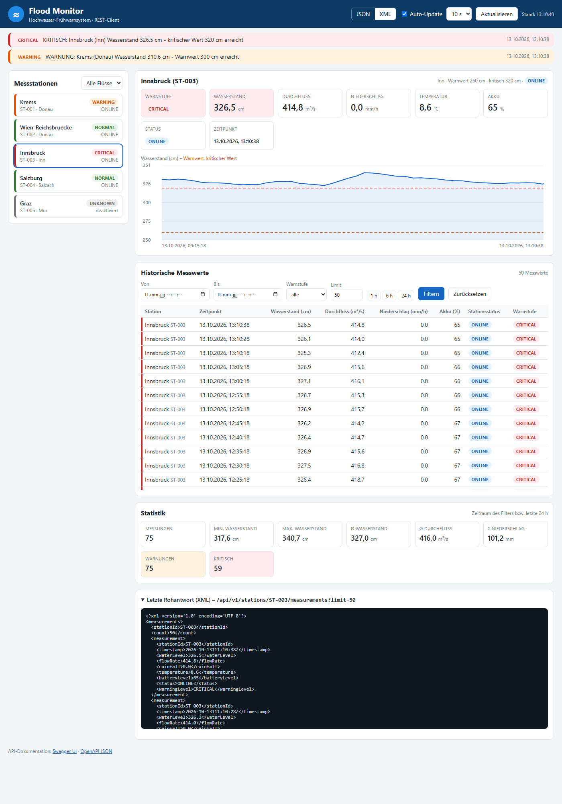
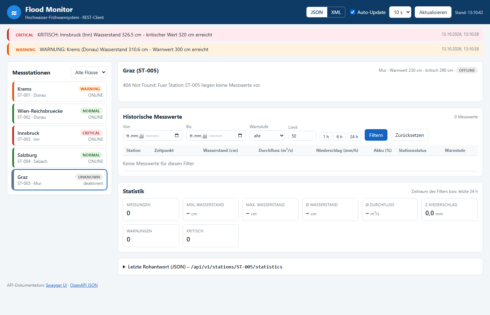
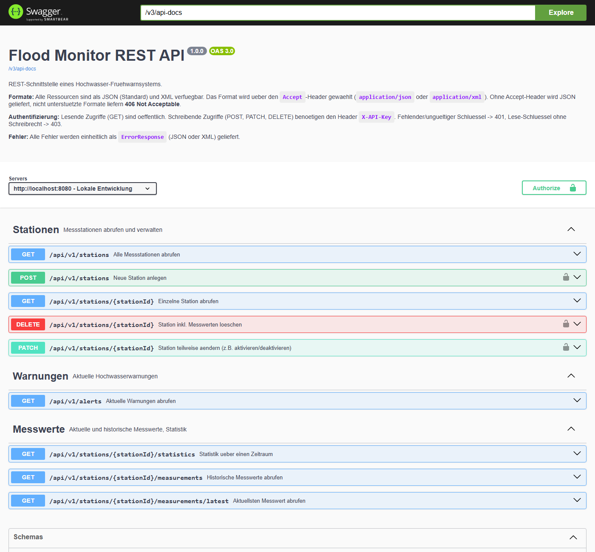

# DEZSYS_GK71 – Flood Monitor REST

REST-Schnittstelle eines **Hochwasser-Frühwarnsystems** mit Spring Boot.
Fünf simulierte Messstationen liefern laufend zusammenhängende Messwerte. Die Daten sind über
`/api/v1` als **JSON und XML** (Content Negotiation über den `Accept`-Header) abrufbar, die Warnstufe
wird serverseitig berechnet und ein jQuery-Webclient visualisiert alles.



## Inhalt

- [Schnellstart](#schnellstart)
- [Konfiguration](#konfiguration)
- [Architektur](#architektur)
- [Datenmodell](#datenmodell)
- [Simulationsregeln](#simulationsregeln)
- [Warnstufen-Regeln](#warnstufen-regeln)
- [REST-API](#rest-api)
- [Beispiele JSON und XML](#beispiele-json-und-xml)
- [Statuscodes und Fehlerbehandlung](#statuscodes-und-fehlerbehandlung)
- [Sicherheit](#sicherheit)
- [Webclient](#webclient)
- [Tests](#tests)
- [API-Dokumentation (OpenAPI)](#api-dokumentation-openapi)
- [Reflexion](#reflexion)
- Weitere Dokumente: [Fragestellungen](docs/FRAGESTELLUNGEN.md) · [AI-Prompts](docs/AI_PROMPTS.md) · [Cheatsheet](docs/CHEATSHEET.md) · [Aufgabenstellung](TASK.md)

---

## Schnellstart

Voraussetzung: **JDK 17 oder neuer**. Gradle muss nicht installiert sein (Gradle Wrapper).

```bash
./gradlew bootRun          # Linux / macOS / Git Bash
gradlew.bat bootRun        # Windows cmd / PowerShell
```

| Was | URL |
|---|---|
| Webclient | http://localhost:8080/ |
| REST-API | http://localhost:8080/api/v1/stations |
| Swagger UI | http://localhost:8080/swagger-ui.html |
| OpenAPI (JSON / YAML) | http://localhost:8080/v3/api-docs · http://localhost:8080/v3/api-docs.yaml |

Beim Start wird eine Historie der letzten 6 Stunden erzeugt (alle 5 Minuten ein Messwert), danach
kommt alle 10 Sekunden pro aktiver Station ein neuer Messwert hinzu.

Weitere Befehle:

```bash
./gradlew test             # automatisierte Tests (Bericht: build/reports/tests/test/index.html)
./gradlew bootJar          # ausfuehrbares JAR in build/libs/
java -jar build/libs/floodmonitor-1.0.0.jar
```

## Konfiguration

`src/main/resources/application.properties` (Auszug), ein vollständiges Beispiel ohne Geheimnisse
liegt in [`application-example.properties`](application-example.properties).

| Property | Standard | Bedeutung |
|---|---|---|
| `simulation.enabled` | `true` | Simulation an/aus (in Tests `false`) |
| `simulation.interval` | `10000` | Simulationsintervall in ms |
| `simulation.backfill-hours` | `6` | Historie beim Start (0 = keine) |
| `simulation.backfill-step-minutes` | `5` | Abstand der Historien-Messwerte |
| `simulation.seed` | leer | fester Seed → reproduzierbare Simulation |
| `warning.max-measurement-age-seconds` | `120` | ältere Messungen gelten als nicht aktuell → `UNKNOWN` |
| `api.max-limit` / `api.default-limit` | `1000` / `100` | Grenzen für `limit` |
| `api.max-range-days` | `31` | maximale Spannweite `from`–`to` |
| `security.api-key.admin` | `${FLOODMONITOR_ADMIN_KEY:dev-admin-key}` | Schlüssel mit Schreibrecht |
| `security.api-key.reader` | `${FLOODMONITOR_READER_KEY:dev-reader-key}` | Schlüssel ohne Schreibrecht (→ 403) |

Beispiel: Intervall 2 s und eigene Schlüssel

```bash
FLOODMONITOR_ADMIN_KEY=geheim ./gradlew bootRun --args='--simulation.interval=2000'
```

> Die Default-Schlüssel `dev-admin-key`/`dev-reader-key` sind nur für die lokale Entwicklung gedacht.
> In Produktion werden die Schlüssel über Umgebungsvariablen gesetzt.

## Architektur



| Schicht | Paket | Aufgabe |
|---|---|---|
| Model | `model` | `Station`, `Location`, `Measurement`, Enums `WarningLevel`, `StationStatus` |
| DTO | `dto` | Antwort-/Request-Objekte: `StationList`, `MeasurementList`, `Alert(List)`, `Statistics`, `ErrorResponse`, `StationCreateRequest`, `StationUpdateRequest` |
| Repository | `repository` | thread-sicherer In-Memory-Speicher, Startdaten (`StationSeedData`) |
| Service | `service` | Geschäftslogik, Filter, Statistik, Warnstufenberechnung, Parametervalidierung, Simulation |
| Controller | `controller` | nur HTTP: Parameter entgegennehmen, Service aufrufen, Statuscode setzen |
| Exception Handling | `exception` | `ApiException`-Hierarchie + zentraler `GlobalExceptionHandler` |
| Security / Config | `security`, `config` | API-Key-Prüfung, Content Negotiation, Sicherheits-Header, OpenAPI, Uhr/Zufall als Beans |
| Client | `src/main/resources/static` | `index.html`, `css/style.css`, `js/app.js` |

Designentscheidungen:
- **Zeit und Zufall sind Beans** (`Clock`, `MeasurementSimulator` mit `Random`) → in Tests durch feste
  Werte ersetzbar.
- `MeasurementSimulator` ist eine reine Java-Klasse ohne Spring → isoliert testbar.
- Listen werden in Wrapper-Objekte verpackt (`{"count":…, "stations":[…]}` bzw.
  `<stations><station>…</station></stations>`), damit JSON und XML dieselbe Struktur haben.

## Datenmodell



Zeitpunkte werden als `java.time.Instant` (UTC) gespeichert und als ISO-8601 ausgegeben
(`2026-05-01T10:15:00Z`). `currentWarningLevel` ist read-only und wird bei jeder Abfrage berechnet.

**Startdaten** (`StationSeedData`):

| ID | Name | Fluss | Normal / Warn / Kritisch (cm) | Besonderheit in der Simulation |
|---|---|---|---|---|
| ST-001 | Krems | Donau | 250 / 300 / 380 | Basispegel 298 cm → pendelt um den Warnwert |
| ST-002 | Wien-Reichsbrücke | Donau | 300 / 450 / 550 | ruhig → NORMAL |
| ST-003 | Innsbruck | Inn | 180 / 260 / 320 | Schneeschmelze, Basispegel 318 cm → WARNING/CRITICAL |
| ST-004 | Salzburg | Salzach | 220 / 380 / 450 | Akku startet bei 19 % → MAINTENANCE |
| ST-005 | Graz | Mur | 150 / 230 / 290 | deaktiviert → keine Messungen, UNKNOWN |

## Simulationsregeln

Implementiert in `MeasurementSimulator`. Jeder neue Messwert wird **aus dem vorherigen Messwert**
berechnet. Ein Simulationsschritt entspricht modellhaft ca. 5 Minuten.

| Größe | Regel |
|---|---|
| **Niederschlag** | Ohne Regen beginnt mit 4 % Wahrscheinlichkeit ein Regenereignis (1–10 mm/h). Während des Regens: Random Walk (σ = 2,5 mm/h, leichte Tendenz +0,3) zwischen 0,2 und 60 mm/h; Ende mit 7 % Wahrscheinlichkeit pro Schritt. |
| **Wasserstand** | `neu = alt + 0,35·Niederschlag − 0,04·(alt − Basispegel) + Rauschen(σ = 0,8 cm)`. Starker Regen erhöht den Pegel, ohne Regen sinkt er langsam zum Basispegel zurück. Änderung pro Schritt max. ±25 cm, Wert nie negativ. |
| **Durchfluss** | Pegel-Abfluss-Beziehung `Q = Q_mittel · (W / W_normal)^1,6` → streng monoton: höherer Wasserstand = höherer Durchfluss, 0 cm → 0 m³/s. |
| **Temperatur** | Random Walk (σ = 0,3 °C) mit Rückkehr zur Basistemperatur; Regen kühlt um 0,05 °C/Schritt. |
| **Akku** | sinkt mit 12 % Wahrscheinlichkeit pro Schritt um 1 % (ganzzahlig, immer 0–100). |
| **Status** | Akku < 15 % → `MAINTENANCE` (misst weiter). In `MAINTENANCE` wird der Akku mit 3 % Wahrscheinlichkeit getauscht → 100 %, `ONLINE`. Akku 0 % → `OFFLINE`, **keine** Messung. `OFFLINE`-Stationen werden mit 2 % Wahrscheinlichkeit repariert. |
| **Deaktiviert** | `isActive = false` oder `OFFLINE` → es werden keine Messungen erzeugt. |

Steuerung: `SimulationScheduler` (`@Scheduled(fixedRateString = "${simulation.interval}")`) ruft
`SimulationService.tick(now)` auf. Der Scheduler ist mit `@ConditionalOnProperty(simulation.enabled)`
abschaltbar – in Tests wird er nicht geladen.

## Warnstufen-Regeln

Implementiert in `WarningLevelCalculator`. Die Warnstufe wird **nur serverseitig** berechnet; ein vom
Client mitgeschicktes Feld (`warningLevel`, `currentWarningLevel`) wird mit 400 abgelehnt.

| Bedingung | Warnstufe |
|---|---|
| Wasserstand ≥ kritischer Wert | `CRITICAL` |
| Wasserstand ≥ Warnwert | `WARNING` |
| **Vorwarnung:** Wasserstand ≥ 90 % des Warnwerts **und** (Anstieg ≥ 10 cm seit letzter Messung **oder** Niederschlag ≥ 20 mm/h) | `WARNING` |
| sonst | `NORMAL` |
| ungültiger Messwert (NaN, negativ) | `UNKNOWN` |

Für die **aktuelle** Warnstufe einer Station (`currentWarningLevel`, Filter, Alerts) gilt zusätzlich:
keine Messung, letzte Messung älter als 120 s, Station deaktiviert oder `OFFLINE` → `UNKNOWN`.

## REST-API

Basis-URL: `http://localhost:8080/api/v1`

| Methode | Endpunkt | Beschreibung | Erfolg |
|---|---|---|---|
| GET | `/stations` | alle Stationen; Filter `river`, `isActive`, `warningLevel` | 200 |
| GET | `/stations/{stationId}` | einzelne Station | 200 |
| GET | `/stations/{stationId}/measurements/latest` | aktuellster Messwert | 200 |
| GET | `/stations/{stationId}/measurements` | Historie; `from`, `to`, `limit`, `warningLevel` | 200 |
| GET | `/stations/{stationId}/statistics` | Statistik; `from`, `to` (Standard: letzte 24 h) | 200 |
| GET | `/alerts` | aktuelle Warnungen; Filter `warningLevel` (WARNING/CRITICAL), `river` | 200 |
| POST | `/stations` | Station anlegen (JSON oder XML), **API-Key** | 201 + `Location` |
| PATCH | `/stations/{stationId}` | Station teilweise ändern (z. B. `isActive`), **API-Key** | 200 |
| DELETE | `/stations/{stationId}` | Station inkl. Messwerte löschen, **API-Key** | 204 |

Parameter-Regeln:
- `from`, `to`: ISO-8601 **mit** Zeitzone (`2026-05-01T08:00:00Z` oder `2026-05-01T10:00:00+02:00`),
  Zeitraum inklusive, `from` ≤ `to`, maximal 31 Tage.
- `limit`: 1–1000, Standard 100. Historie wird **neueste zuerst** geliefert.
- `warningLevel`: `NORMAL`, `WARNING`, `CRITICAL`, `UNKNOWN` (Groß-/Kleinschreibung egal).
- `river`: Groß-/Kleinschreibung egal. Alle Filter werden UND-verknüpft.
- Statistik: `minWaterLevel`, `maxWaterLevel`, `averageWaterLevel`, `averageFlowRate`, `totalRainfall`
  (Summe der mm/h-Werte), `measurementCount`, `warningCount` (WARNING + CRITICAL), `criticalCount`.

## Beispiele JSON und XML

Weitere echte Antworten liegen in [`docs/examples/`](docs/examples).

```bash
# JSON (Standard, auch ohne Accept-Header)
curl -H "Accept: application/json" http://localhost:8080/api/v1/stations/ST-001/measurements/latest
```
```json
{
  "stationId": "ST-001",
  "timestamp": "2026-10-13T11:08:21Z",
  "waterLevel": 304.8,
  "flowRate": 2609.6,
  "rainfall": 7.3,
  "temperature": 12.5,
  "batteryLevel": 88,
  "status": "ONLINE",
  "warningLevel": "WARNING"
}
```

```bash
# XML
curl -H "Accept: application/xml" http://localhost:8080/api/v1/stations/ST-001/measurements/latest
```
```xml
<?xml version='1.0' encoding='UTF-8'?>
<measurement>
  <stationId>ST-001</stationId>
  <timestamp>2026-10-13T11:08:21Z</timestamp>
  <waterLevel>304.8</waterLevel>
  <flowRate>2609.6</flowRate>
  <rainfall>7.3</rainfall>
  <temperature>12.5</temperature>
  <batteryLevel>88</batteryLevel>
  <status>ONLINE</status>
  <warningLevel>WARNING</warningLevel>
</measurement>
```

Weitere Anfragen:

```bash
# Filter
curl "http://localhost:8080/api/v1/stations?river=Donau"
curl "http://localhost:8080/api/v1/stations?isActive=true"
curl "http://localhost:8080/api/v1/stations?warningLevel=CRITICAL"
curl -H "Accept: application/xml" "http://localhost:8080/api/v1/alerts?warningLevel=WARNING&river=Donau"

# Historie (Zeitraum anpassen: die Simulation erzeugt Daten der letzten 6 Stunden)
curl "http://localhost:8080/api/v1/stations/ST-001/measurements?from=2026-05-01T08:00:00Z&to=2026-05-01T12:00:00Z&limit=100"
curl "http://localhost:8080/api/v1/stations/ST-003/measurements?warningLevel=CRITICAL&limit=5"

# Statistik
curl "http://localhost:8080/api/v1/stations/ST-001/statistics"

# Station anlegen (JSON) -> 201 Created
curl -i -X POST http://localhost:8080/api/v1/stations \
  -H "X-API-Key: dev-admin-key" -H "Content-Type: application/json" \
  -d '{"id":"ST-010","name":"Melk","river":"Donau","location":{"latitude":48.2269,"longitude":15.3436},"normalWaterLevel":260,"warningWaterLevel":350,"criticalWaterLevel":450}'

# Station anlegen (XML)
curl -i -X POST http://localhost:8080/api/v1/stations \
  -H "X-API-Key: dev-admin-key" -H "Content-Type: application/xml" -H "Accept: application/xml" \
  -d '<station><id>ST-011</id><name>Hall</name><river>Inn</river><location><latitude>47.28</latitude><longitude>11.5</longitude></location><normalWaterLevel>170</normalWaterLevel><warningWaterLevel>250</warningWaterLevel><criticalWaterLevel>310</criticalWaterLevel></station>'

# Station deaktivieren / loeschen
curl -X PATCH http://localhost:8080/api/v1/stations/ST-010 -H "X-API-Key: dev-admin-key" \
  -H "Content-Type: application/json" -d '{"isActive":false}'
curl -i -X DELETE http://localhost:8080/api/v1/stations/ST-010 -H "X-API-Key: dev-admin-key"
```

## Statuscodes und Fehlerbehandlung

Alle Fehler werden zentral im `GlobalExceptionHandler` (`@RestControllerAdvice`) behandelt und
einheitlich ausgegeben – als XML, wenn der Client XML bevorzugt, sonst als JSON. **Stacktraces werden
nie ausgeliefert** (nur ins Server-Log), zusätzlich `server.error.include-stacktrace=never`.

```json
{
  "timestamp": "2026-05-01T10:20:00Z",
  "status": 404,
  "error": "Not Found",
  "message": "Station ST-999 wurde nicht gefunden",
  "path": "/api/v1/stations/ST-999"
}
```

| Status | Wann (Beispiele) |
|---|---|
| 200 OK | erfolgreiche GET/PATCH-Anfrage |
| 201 Created | `POST /stations` (mit `Location`-Header) |
| 204 No Content | `DELETE /stations/{id}` |
| 400 Bad Request | `from` nach `to`, Zeitraum > 31 Tage, ungültiges Datumsformat, ungültige Warnstufe, `limit` < 1 oder > 1000 oder keine Zahl, `isActive=abc`, ungültiger/unvollständiger Body, Grenzwerte nicht aufsteigend, vom Client mitgeschickte Warnstufe |
| 401 Unauthorized | schreibender Zugriff ohne oder mit unbekanntem `X-API-Key` (+ `WWW-Authenticate`) |
| 403 Forbidden | schreibender Zugriff mit Lese-Schlüssel |
| 404 Not Found | unbekannte Station, keine Messwerte vorhanden, unbekannter Pfad |
| 405 Method Not Allowed | z. B. `POST /alerts` |
| 406 Not Acceptable | `Accept` ist weder JSON noch XML (z. B. `text/csv`) – Fehlerbody dann in JSON |
| 409 Conflict | Station mit dieser ID existiert bereits |
| 415 Unsupported Media Type | Request-Body nicht JSON/XML (z. B. `text/plain`) |
| 500 Internal Server Error | unerwarteter Fehler – generische Meldung ohne Details |

## Sicherheit

- **Authentifizierung über API-Key** (`ApiKeyInterceptor`): GET ist öffentlich, POST/PATCH/DELETE
  brauchen `X-API-Key`. Fehlend/unbekannt → 401, Lese-Schlüssel → 403. Vergleich zeitkonstant
  (`MessageDigest.isEqual`). Schlüssel kommen aus Umgebungsvariablen, nicht aus dem Code.
- **Eingabevalidierung**: alle Query-Parameter werden geprüft, Bodies mit Bean Validation (`@Valid`),
  unbekannte JSON/XML-Felder werden abgelehnt (`fail-on-unknown-properties`).
- **Ressourcenschutz**: `limit` max. 1000, Zeitraum max. 31 Tage, Historie pro Station begrenzt.
- **Keine internen Details** in Fehlermeldungen (keine Stacktraces, keine Exception-Namen).
- **Sicherheits-Header** (`SecurityHeadersFilter`): `X-Content-Type-Options: nosniff`,
  `X-Frame-Options: DENY`, `Referrer-Policy: no-referrer`, `Cache-Control: no-store` für die API.
- Der Webclient fügt Serverdaten nur HTML-escaped ins DOM ein (Schutz vor XSS).
- Hinweis: Für den Produktivbetrieb wäre zusätzlich HTTPS (TLS) nötig, da der API-Key sonst im Klartext übertragen wird.

## Webclient

`http://localhost:8080/` – HTML, CSS und jQuery (`src/main/resources/static`).

- lädt Stationen (mit Fluss-Filter) und zeigt die aktuelle Warnstufe farbig an
- zeigt den aktuellen Messwert der gewählten Station und einen Verlauf des Wasserstands mit Warn- und
  kritischem Wert
- historische Messwerte als Tabelle (Station, Zeitpunkt, Wasserstand, Durchfluss, Niederschlag, Akku,
  Stationsstatus, Warnstufe) mit Filter nach Zeitraum (`von`/`bis`, Schnellwahl 1 h/6 h/24 h),
  Warnstufe und Limit
- Statistik und aktuelle Warnungen (Banner)
- **Umschalter JSON/XML**: setzt den `Accept`-Header; XML-Antworten werden mit `$.parseXML` ausgewertet
  und in dieselben Objekte umgewandelt wie JSON. Die letzte Rohantwort ist unten einsehbar.
- **Auto-Update** (5/10/30/60 s, abschaltbar), Ladeanzeige, verständliche Fehlermeldungen (aus dem
  `message`-Feld der JSON- oder XML-Fehlerantwort)
- Farben: NORMAL grün, WARNING orange, CRITICAL rot, UNKNOWN grau
- Startzustand per URL möglich: `/?format=xml&station=ST-003&raw=1`

| JSON | XML (mit Rohantwort) |
|---|---|
|  |  |

| Deaktivierte Station (UNKNOWN, 404 wird lokal angezeigt) | Swagger UI |
|---|---|
|  |  |

## Tests

```bash
./gradlew test
```

54 Tests, alle deterministisch:
- **Simulation abgeschaltet** (`simulation.enabled=false` im Profil `test`), Historie aus
- **feste Uhr** (`TestClockConfig`: 2026-05-01T12:00:00Z), fest definierte Messwerte vor jedem Test
- Simulator-Tests mit festem Seed bzw. festen Zufallswerten

| Testklasse | Inhalt |
|---|---|
| `FloodMonitorApiTest` | Stationen als JSON / XML / ohne Accept, existierende & unbekannte Station, aktuellster Messwert (JSON+XML), Filter nach Zeitraum, Zeitzonen, `from` > `to`, ungültiges Datum, Warnstufe NORMAL / WARNING / CRITICAL / UNKNOWN, ungültige Warnstufe, Limit inkl. **maximales Limit** (1000 ok, 1001 → 400), Fluss-/Aktiv-Filter, Alerts, Statistik, **nicht unterstütztes Format (406)**, Fehler als XML |
| `StationWriteApiTest` | 401 ohne/mit falschem Key, 403 mit Lese-Key, 201 + Location, 409, POST mit XML-Body, 415, 400 bei Warnstufe im Body / ungültigem Body, PATCH, 204 DELETE, 405 |
| `WarningLevelCalculatorTest` | Grenzwerte NORMAL/WARNING/CRITICAL, UNKNOWN bei ungültigen Werten, Vorwarnregel, veraltete Messung |
| `MeasurementSimulatorTest` | Wertebereiche über 5000 Schritte, max. Änderung pro Schritt, gleicher Seed = gleiche Folge, Regen erhöht Pegel, Durchfluss monoton, MAINTENANCE/OFFLINE/Akkutausch, keine Messung für inaktive Stationen, Aufbau auf vorherigem Messwert |

## API-Dokumentation (OpenAPI)

- Laufzeit: Swagger UI unter http://localhost:8080/swagger-ui.html, Spezifikation unter `/v3/api-docs`
- Export im Repository: [`docs/openapi.yaml`](docs/openapi.yaml), [`docs/openapi.json`](docs/openapi.json)

Die Spezifikation wird von *springdoc-openapi* aus dem Code erzeugt und enthält Endpunkte, Methoden,
Parameter (inkl. erlaubter Werte), Request- und Response-Bodies, beide Formate (JSON/XML), alle
Statuscodes mit `ErrorResponse`-Schema sowie das Security-Schema `apiKey` (`X-API-Key`).
Neu exportieren bei laufender Anwendung:

```bash
curl http://localhost:8080/v3/api-docs.yaml -o docs/openapi.yaml
```

## Reflexion

Aufgetretene Probleme und Lösungen:

1. **XML-Listen:** `List<Station>` wird von Jackson XML als `<List><item>…</item></List>` ausgegeben.
   Lösung: eigene Wrapper-Klassen (`StationList`, …) mit `@JacksonXmlRootElement` und
   `@JacksonXmlElementWrapper(useWrapping = false)` – JSON und XML haben jetzt dieselbe Struktur.
2. **`isActive` hieß in JSON plötzlich `active`**, weil Jackson das `is`-Präfix des Boolean-Getters
   entfernt. Lösung: `@JsonProperty("isActive")`.
3. **Akkustand sank nie:** Der Akku wurde pro Schritt um 0,05–0,15 % reduziert, aber als `int`
   gespeichert und gerundet – beim nächsten Schritt war er wieder gleich. Lösung: mit 12 %
   Wahrscheinlichkeit um ganze 1 % senken (gleicher Mittelwert).
4. **406-Fehlerantwort leer:** Wenn der Client z. B. `text/csv` will, kann auch die Fehlermeldung nicht
   in diesem Format geschrieben werden. Lösung: Im Handler wird der `Content-Type` der Fehlerantwort
   explizit gesetzt (JSON bzw. XML nach Accept-Header).
5. **`/v3/api-docs.yaml` lieferte 406**, nachdem JSON als Standardformat konfiguriert war (`*/*` wurde
   zu „nur JSON"). Lösung: `defaultContentType(APPLICATION_JSON, ALL)`.
6. **XML-Deklaration fehlte** im Vergleich zum Beispiel der Angabe. Lösung:
   `ToXmlGenerator.Feature.WRITE_XML_DECLARATION` im XML-Converter aktivieren.
7. **Deterministische Tests:** Simulation, Systemzeit und Zufall machten Tests instabil. Lösung:
   Scheduler per Property abschaltbar, `Clock` als Bean (in Tests fix), Simulator mit injiziertem `Random`.
8. **Webclient-Race-Condition:** Die Tabelle zeigte manchmal die Stations-ID statt des Namens, weil die
   Historie vor der Stationsliste geladen war. Lösung: erst Stationen laden, dann die Detaildaten.
9. **Gradle-Download** schlug in einer Umgebung mit TLS-inspizierendem Proxy fehl (Zertifikat nicht im
   Java-Truststore). Lösung: `./gradlew … -Djavax.net.ssl.trustStoreType=Windows-ROOT` verwendet den
   Windows-Zertifikatsspeicher.

Erkenntnisse: Content Negotiation ist in Spring Boot fast „gratis", die Details (Listen in XML,
Fehlerformate, Default-Format) brauchen aber Aufmerksamkeit. Eine saubere Schichtentrennung hat sich
beim Testen ausgezahlt: Simulation und Warnstufen konnten ohne HTTP getestet werden.

## Verwendete Technologien

Java 17+, Spring Boot 3.3 (Web, Validation), Jackson (JSON + `jackson-dataformat-xml`),
springdoc-openapi 2.6 (OpenAPI 3 + Swagger UI), JUnit 5 / MockMvc / AssertJ, Gradle 8.7 Wrapper,
HTML / CSS / jQuery 3.7.

## AI-Unterstützung

Die Umsetzung erfolgte mit Unterstützung von Claude Code; die Prompts sind in
[`docs/AI_PROMPTS.md`](docs/AI_PROMPTS.md) dokumentiert.
